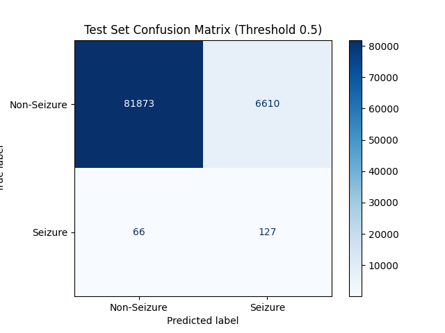
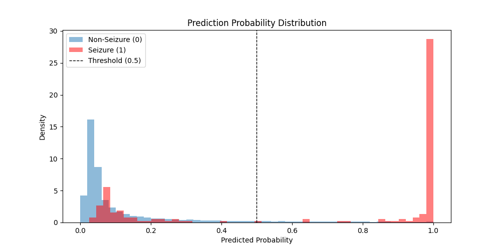

# EEG Seizure Classification Project

Patient-wise seizure detection on scalp EEG from the Siena dataset. 2 s EEG windows are converted to STFT spectrograms and classified (seizure vs non-seizure) by a small 2D CNN.

My first end-to-end ML project: working with raw EEG, a heavily imbalanced dataset, patient-level validation, and optimizing training. Training was done with a laptop running a Nvidia RTX 4070 mobile and an i9-14900HX processor.

## Pipeline

1. **Preprocess** (`preprocess.py`): read EDF, keep 18 standard channels, 50 Hz notch, 1-40 Hz Butterworth bandpass, cut into 2 s windows with 1 s overlap, compute STFT, take log1p magnitude, cache per patient as `.npz`.
2. **Dataset** (`dataset.py`): load cached spectrograms, z-score per patient and per channel.
3. **Model** (`model.py`): depthwise conv (each EEG channel gets its own filters), then a conv to 64 maps, batch norm, pooling, global average pool, small MLP, one logit.
4. **Train** (`train.py`): 5-fold GroupKFold split by patient, so no patient appears in both train and eval. BCE loss with `pos_weight=10`. Checkpoints on best recall, early stopping, Ctrl+C saves state.
5. **Test** (`test.py`): evaluates the best fold checkpoint on held-out patients and saves a confusion matrix and probability histogram.

## Data

Siena Scalp EEG Database on PhysioNet:
https://physionet.org/content/siena-scalp-eeg/1.0.0/

Download it and arrange it like this:

```
siena/
  PN00/
    PN00-1.edf
    Seizures-list-PN00.txt
  PN01/
  ...
```

The data is not included in this repo.

## Split

- **Cross-validation (11 patients):** PN00, PN03, PN05, PN06, PN09, PN10, PN12, PN13, PN14, PN16, PN17
- **Held-out test (3 patients):** PN01, PN07, PN11

## Setup

```
pip install -r requirements.txt
```

## Run

```
python preprocess.py   # builds siena_stft_cache/ (slow, run once)
python train.py        # 5-fold CV, checkpoints go to checkpoints/
python test.py         # evaluates on held-out patients
```

Set `THRESHOLD` in `test.py` using the threshold sweep printed by `train.py`.

## Results

Held-out test patients: PN01, PN07, PN11. Threshold 0.5. Window-level metrics.

| Metric | Value |
|---|---|
| ROC-AUC | 90.00% |
| Recall (seizure) | 65.80% |
| Precision (seizure) | 1.89% |
| Specificity | 92.53% |
| F1 (seizure) | 3.67% |




**Takeaways**
- The test set is extremely imbalanced: 193 seizure windows vs 88,483 non-seizure (0.22%).
- The model catches about two thirds of seizure windows but raises many false alarms, so precision is very low.
- Checkpoints were selected on recall, which rewards over-predicting seizures.

## Limitations and future work

- Select checkpoints and threshold on AUCPR or F1 instead of recall.
- Report event-level sensitivity and false alarms per hour, not just window-level metrics.
- Tune the decision threshold and `pos_weight` on a validation set, not the eval fold.
- Try temporal smoothing across consecutive windows to cut isolated false alarms.
- Per-patient normalization uses the full recording, which is not causal for real-time use.

## Notes

- Delete `siena_stft_cache/` if you change window length, STFT settings, or filters. The cache does not detect parameter changes.
- Delete `checkpoints/` to retrain from scratch. Otherwise `train.py` resumes from the last saved epoch.
